# Eventages QrCode Studio

[English](./README.md) · **Français**

Application desktop (Tauri 2) de création de QR codes — **100 % locale, hors ligne, sans compte, sans serveur**. Chaque génération, chaque export et chaque donnée restent sur votre machine.

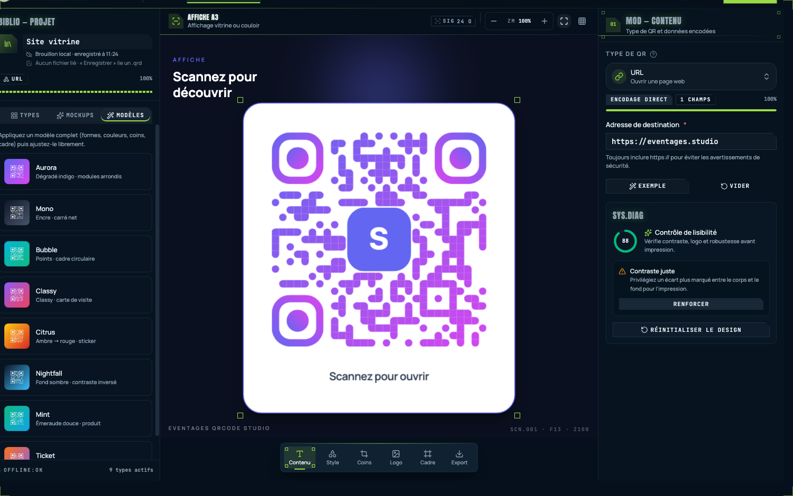

## En résumé

- **22 types de QR** — URL, Wi-Fi, vCard, SMS, WhatsApp, email, événement, code-barres… plus les pages autonomes (menu, PDF, galerie…) préparées pour la prochaine version, visibles dans la galerie comme *Bientôt* ;
- **Modèle par projets** — le brouillon reste modifiable à vie, la publication est une étape d'export volontaire, et rien ne quitte jamais votre appareil ;
- **Personnalisation approfondie** — formes de modules, couleurs et dégradés, marqueurs de coins, logo, cadres avec libellé, et modèles de design complets ;
- **Mises en situation réelles** — aperçu du code sur une affiche A3, une carte de visite, un chevalet de table, un packaging, un écran TV, un sticker ou un T-shirt ;
- **Contrôle de lisibilité** — score de scannabilité de 0 à 100 avec corrections en un clic (contraste, correction d'erreur, protection du logo) ;
- **Import local** — ouvrez l'image, le SVG ou le PDF d'un code existant : il est décodé et redevient un projet modifiable ;
- **Espace de travail à onglets** — chaque projet s'ouvre dans son propre onglet ;
- **CLI headless** — le même moteur scriptable en terminal (`eventages-qr` / `eqr`).

## Projets & onglets de l'espace de travail

L'onglet Accueil est un registre permanent de projets : créer, ouvrir, dupliquer, supprimer, rechercher et filtrer par type. Ouvrir un projet lui dédie un onglet dans la barre de titre — l'accueil reste toujours à portée de clic. Chaque brouillon est enregistré automatiquement dans le registre local ; lier un fichier `.qrd` (*Quick Response Document*) adosse le projet à un vrai fichier sur disque (enregistrement manuel ⌘S ou auto-enregistré).

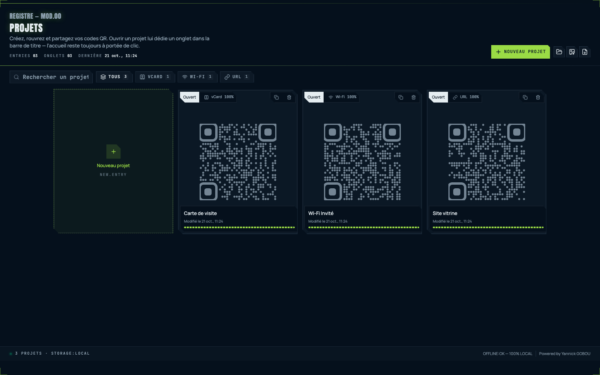

Raccourcis : ⌘N nouveau projet, ⌘O ouvrir un fichier `.qrd`/`.qcp`, ⌘I importer un code existant, ⌘W fermer l'onglet, ⌘S enregistrer, ⇧⌘S enregistrer sous, ⇧⌘E exporter, ⌘Z / ⇧⌘Z annuler/rétablir (historique global du projet), ⌘+ / ⌘− zoom de l'aperçu.

## Galerie des types de QR

Les types sont regroupés par familles (Essentiels, Contact, Web & réseaux, Commerce, Événements, Média, Avancé) avec recherche et filtrage instantané.

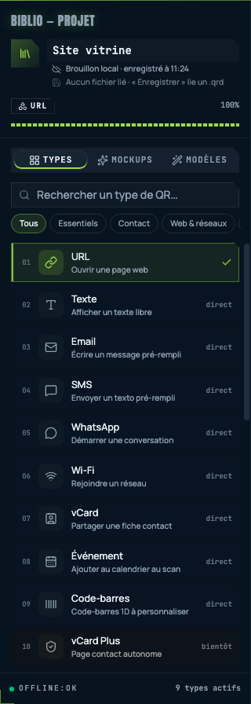

| Type | Contenu encodé | Encodage |
| --- | --- | --- |
| URL, Texte | Lien ou texte libre | Direct |
| Wi-Fi | Rejoindre un réseau (SSID, WPA/WPA2/WPA3/WEP, masqué) | Direct |
| Email / SMS / WhatsApp | Message ou conversation pré-remplis | Direct |
| vCard | Fiche contact complète | Direct |
| Événement | Ajout au calendrier (iCalendar) | Direct |
| Code-barres (1D) | EAN-13, CODE-128, … rendu 1D dédié | Direct |
| Menu, Produit, Coupon, PDF, Vidéo, Images, MP3, Playlist, Landing, Business, Feedback, App, vCard Plus, Liste de liens, Réseaux sociaux | Pages HTML autonomes à héberger soi-même | Page • *Bientôt* |

Chaque type a son formulaire typé (validation d'URL, mot de passe, listes, interrupteurs, téléversement de fichier…) avec jauge de complétion et bouton **Exemple** pour remplir un jeu de démonstration réaliste.

## Personnaliser le design

### Formes, couleurs & robustesse (Style)

Six formes de modules, couleur unie ou dégradé (avec angle), fonds colorés ou fond transparent, niveau de correction d'erreur (L/M/Q/H) et largeur de zone de silence.

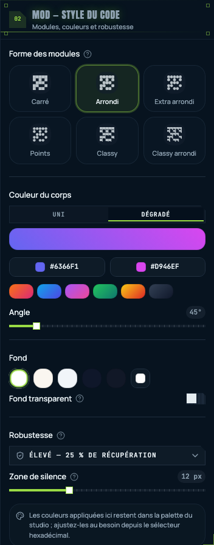

### Marqueurs de coins (Coins)

Les repères de position se restylent indépendamment du corps (carré, arrondi, cercle, doux, classy) — couleurs reprises ou distinctes.

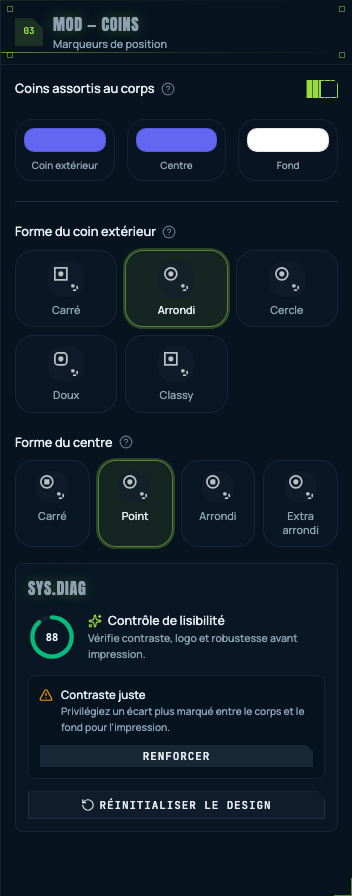

### Logo central

Téléversez un logo carré (PNG/JPG/SVG, stocké localement) ou choisissez-en un dans la bibliothèque vectorielle intégrée. Taille du logo, marge de protection et compensation des modules masqués s'ajustent au niveau de correction d'erreur.

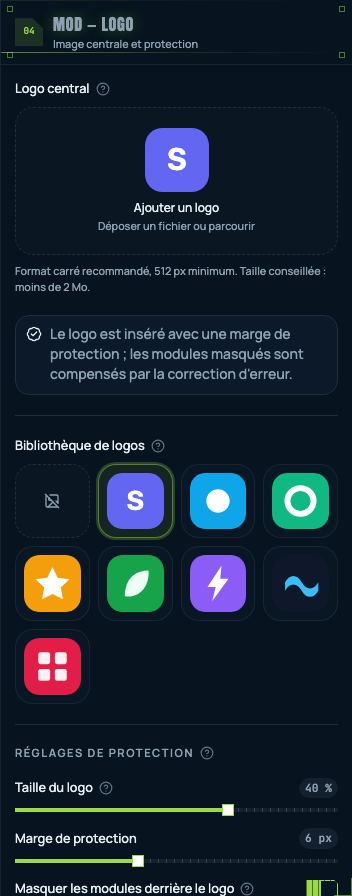

### Cadre & libellé (Cadre)

Une douzaine de cadres numérotés (rayon, bordure, accent réglables) plus un libellé optionnel (« Scannez pour ouvrir ») avec sa typographie et ses couleurs. Le même calcul géométrique alimente l'aperçu à l'écran et le fichier exporté : ce que vous voyez est exactement ce que vous obtenez.

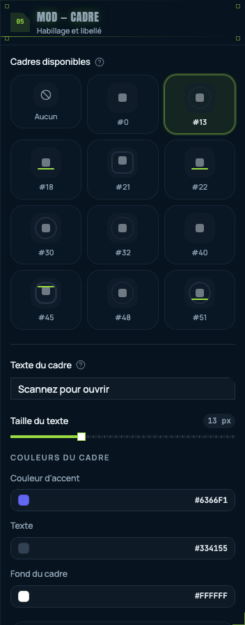

### Mises en situation (Mockups)

Changez le décor de la scène pour visualiser le code dans son contexte réel (décoratif : le code lui-même n'est jamais altéré).

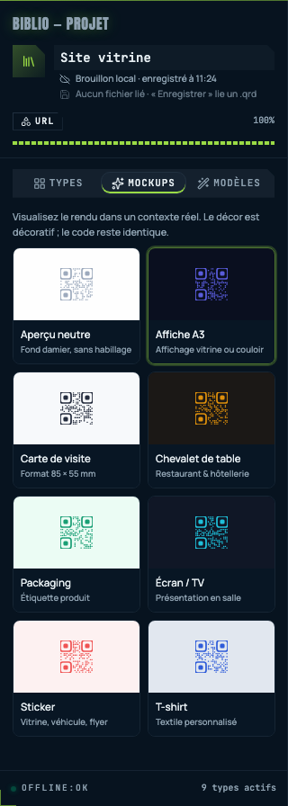

### Modèles de design

Appliquez un habillage complet en un clic (formes, couleurs, coins, cadre) depuis huit modèles — Aurora, Mono, Bubble, Classy, Citrus, Nightfall, Mint, Ticket — puis ajustez librement chaque détail.

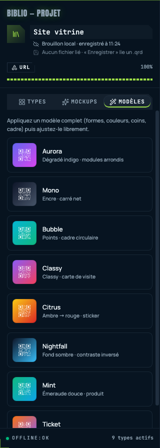

### Contrôle de lisibilité (SYS.DIAG)

Chaque modification met à jour un score de scan de 0 à 100 avec des alertes concrètes (contraste faible, correction d'erreur insuffisante avec un logo, payload trop dense…) et des corrections en un clic (*Renforcer*).

## Importer un code existant

Donnez une seconde vie à un ancien code : choisissez une image, un SVG ou un PDF contenant un QR ou un code-barres 1D, le moteur local le décode, détecte le type de contenu (URL, Wi-Fi, vCard, SMS, événement, EAN…) et pré-remplit un nouveau projet modifiable — les réglages de design sont restaurés quand ils sont reconnaissables. La conversion s'exécute hors du thread principal avec une progression en direct ; l'application reste utilisable pendant le traitement.

## Export & partage

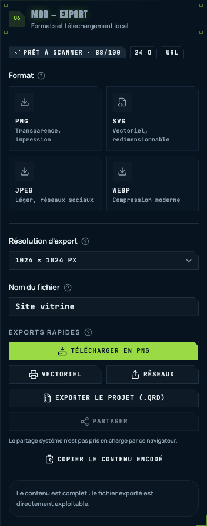

- **Formats** : PNG (transparence), JPEG, WEBP et SVG (totalement vectoriel) de 512 à 4096 px ;
- **Exports rapides** : téléchargement direct, version vectorielle, accès en un clic aux formats ci-dessus ;
- **Archive `.qrd`** — un fichier unique qui contient tout le projet (contenu, design, logo), rouvrable dans l'app desktop et interchangeable avec la CLI (les archives `.qcp` historiques restent acceptées) ;
- **Feuille de partage système** (nativement sous Tauri, Web Share côté navigateur) et **copie du contenu encodé** dans le presse-papiers.

## Paramètres, thèmes & confidentialité

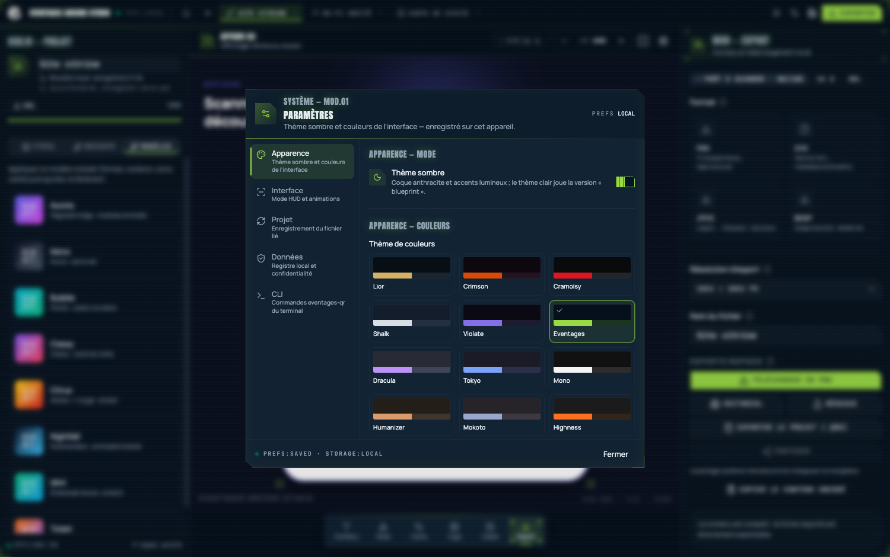

- **Apparence** — mode sombre/clair et 12 thèmes de couleurs (Eventages, Mono, Dracula, Tokyo Night…) ;
- **Interface** — la direction artistique HUD (coins coupés, typo mono, crans) peut être désactivée entièrement (*mode HUD* off) ;
- **Projet** — comportement du fichier `.qrd` lié et enregistrement automatique ;
- **Données** — tout (projets, brouillons, designs, logos) reste sur cette machine : aucun compte, aucune synchronisation, aucune télémétrie, aucun appel réseau. Les QR imprimés fonctionnent hors ligne pour toujours ;
- **CLI** — un interrupteur installe les commandes `eventages-qr` et `eqr` dans le PATH (liens symboliques dans `/usr/local/bin` sous macOS) ; le retirer les supprime.

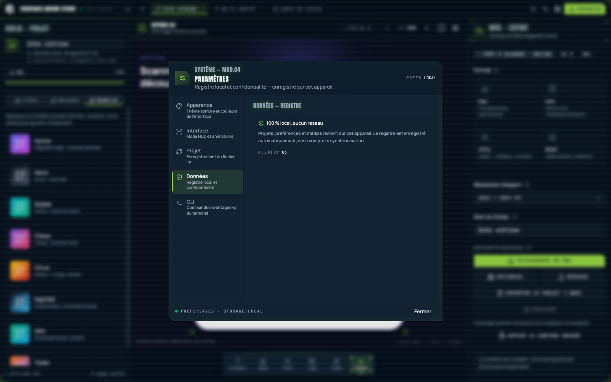

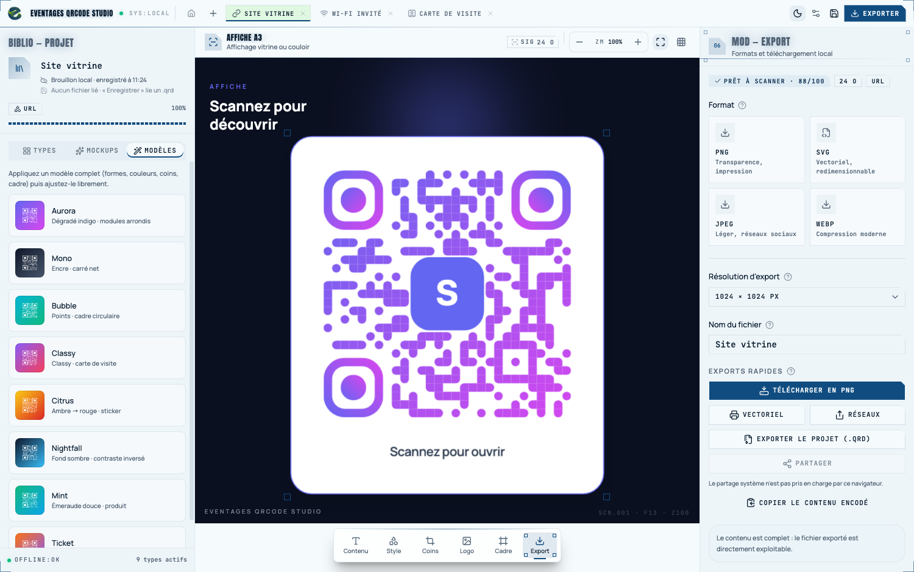

## CLI headless (`eventages-qr`)

Créer, gérer et composer des projets QR sans interface, depuis un terminal ou un
script — mêmes modules que l'app (`qr-catalog`, `qr-payload`, `qr-design`,
`qr-frame`, `qcp`), même tracé de rendu que l'aperçu. La commande existe sous
deux noms : `eventages-qr` et son alias court `eqr`.

```sh
eventages-qr help               # aide complète (ou `eqr`)
bun run cli types               # équivalent en développement

eventages-qr init               # préparer ./studio (ou EVENTAGES_QR_DIR, ou --dir …)
eventages-qr create "Wi-Fi invité" --type wifi \
  --set ssid=Invités --set password=bienvenue --template mint
eventages-qr list
eventages-qr payload "Wi-Fi invité"

eventages-qr set "Wi-Fi invité" --set password=nouvelcode --design dotsColor=#10b981
eventages-qr render "Wi-Fi invité" -o affiche.png --size 2048   # SVG avec --format svg
eventages-qr pack "Wi-Fi invité"   # → archive .qrd (Quick Response Document) ouvrable dans l'app desktop
eventages-qr import projet.qrd     # et l'inverse (les archives .qcp historiques restent acceptées)

eventages-qr duplicate "Wi-Fi invité"
eventages-qr delete "Wi-Fi invité"
```

Espace de travail : un fichier JSON par projet (`./studio`, substituable par
l'option `--dir` ou `EVENTAGES_QR_DIR` — les anciens `EVENTAGES_LITE_DIR` et
`QRS_STUDIO_DIR` restent acceptés). Composition SVG sans DOM, PNG via
`@resvg/resvg-js` ; `--no-frame`, `--size` et `--design clé=valeur` permettent de
composer une variante sans modifier le projet (`eventages-qr help <commande>`
pour le détail de chaque commande).

## Développement

```sh
bun install          # installer les dépendances (bun obligatoire)
bun run tauri dev    # lancer l'app desktop en développement
bun run build        # typecheck + build production (à valider avant toute fin de modification UI)
```

### Stack

- **Tauri 2** + **React 19** + **TypeScript**
- **Tailwind CSS v4** (config CSS-first dans `src/index.css`, `@theme inline`)
- **shadcn/ui**, style `base-nova` (primitives Base UI)
- **Icônes : [lucide-react](https://lucide.dev/icons)** — set unique pour toute l'interface. Aucune autre librairie d'icônes, aucun SVG d'icône écrit à la main, aucun emoji utilisé comme icône. Les seuls SVG inline du code sont des graphiques fonctionnels (aperçus de motifs QR, jauge de score), pas des icônes UI.
- Polices : Manrope Variable (sans) et JetBrains Mono Variable (mono), embarquées en sous-ensembles latins dans `src/index.css`

## Documentation

- [`AGENTS.md`](./AGENTS.md) — conventions à suivre pour travailler sur ce dépôt (dont la règle « icônes lucide-react uniquement »)
- [`docs/`](./docs/README.md) — specs produit (SpecKit) et checklists par fonctionnalité
- [`docs/images/`](./docs/images) — les captures d'écran utilisées dans ce README

## IDE recommandé

- [VS Code](https://code.visualstudio.com/) + [Tauri](https://marketplace.visualstudio.com/items?itemName=tauri-apps.tauri-vscode) + [rust-analyzer](https://rust-lang.github.io/rust-analyzer/)
